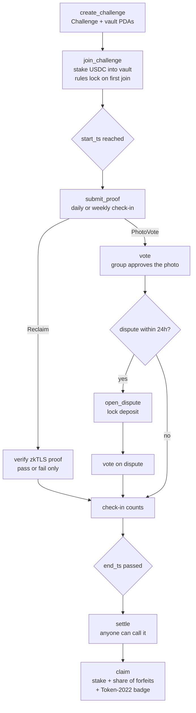

# Piroba architecture

> **Status: design only.** Everything here is planned. The program in
> `programs/piroba` declares these accounts and instructions, but every
> instruction body is a `TODO`.

## Accounts and PDAs

| Account | PDA seeds | Holds |
|---|---|---|
| `Challenge` | `["challenge", creator, challenge_id (u64 LE)]` | creator, challenge_id, stake_mint, stake_amount, start_ts, end_ts, proof_kind, participant_count, settled, bump, vault_bump |
| Vault (token account) | `["vault", challenge]` | All staked USDC. Its authority is the `Challenge` PDA, so only the program can move funds. |
| `Participant` | `["participant", challenge, user]` | challenge, user, checkins, completed, claimed, bump |
| `Dispute` | `["dispute", participant, checkin_index (u16 LE)]` | challenge, target, opener, deposit, opened_ts, uphold/reject vote counts, resolved, bump |

`ProofKind` is either `Reclaim` (zkTLS) or `PhotoVote`.

Constants we plan to use: `FORFEIT_FEE_BPS = 1000` (10%) and `DISPUTE_WINDOW_SECS = 86400` (24h).

## Instruction flow



### Settlement math (planned)

```
forfeited  = stake_amount × (participants − finishers)
fee        = forfeited × 10%
payout     = stake_amount + (forfeited − fee) / finishers
```

Edge cases still to decide: what happens if nobody finishes (refund minus fee, or everything to the treasury), what happens if everybody finishes (everyone gets their stake back with no fee), and how to handle rounding dust.

## Proof flow

### Reclaim zkTLS (e.g. Strava)

1. The user connects their fitness account in the Reclaim flow, off-chain.
2. Reclaim produces a zkTLS proof of a claim such as "ran ≥ 5 km on day X". Only pass/fail is revealed, not the route or other activity data.
3. The client sends the proof to `submit_proof`. The program (or a Reclaim verifier it calls) checks the attestor signatures and the claim, then increments `checkins`.
4. Open question: whether to verify fully on-chain or verify an attestor signature only. Roadmap step 2 is a devnet spike to answer this.

### Photo + group vote

1. The user uploads a photo off-chain and calls `submit_proof` with its hash.
2. Other participants call `vote`. A majority approves the check-in.
3. For 24h any participant can call `open_dispute` and lock a dispute deposit.
4. The group votes on the dispute:
   - **Upheld:** the check-in is removed and the opener gets their deposit back.
   - **Rejected:** the check-in stands and the deposit is forfeited to the pot.
5. The deposit discourages spam disputes. The 24h window keeps settlement predictable.

## Off-chain pieces (planned)

- **Blink / Action endpoints** that build `join_challenge` and `submit_proof` transactions from a link.
- **A fee sponsor** that pays transaction fees for embedded email/passkey wallets.
- **A Next.js app and Telegram Mini App** for creating challenges, uploading photos and voting.
